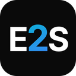

Developer based in Milan, Italy. I build native apps for macOS and iOS, full-stack web products, and AI tools built on open-source models, working across macOS and Linux. I take projects from idea to release.

I prefer local-first software: my apps collect no telemetry, require no accounts, and keep data on the user's device.

[Portfolio](https://mffprojects.com/Portfolio/en/) · [LinkedIn](https://www.linkedin.com/in/mattia-fossati-6b94a02a6)

             

---

## macOS apps

Five apps publicly released and actively maintained, with 35+ releases since October 2026. Each ships as a DMG signed with Developer ID and notarized by Apple, built by an automated release pipeline, and updates itself in one click after verifying the new build's signature and notarization.

| App | What it does | Highlights | Download |
|---|---|---|---|
|  [Lumika](https://mffprojects.com/Portfolio/en/progetti/lumika/) | Finds files and mail on your Mac by meaning: documents, photos, voice notes, code, Apple Mail messages and attachments | Language model running on-device, no cloud; search scoped by folder, disk or mailbox; battery-aware indexing. macOS 27+, Apple silicon | [Latest release](https://github.com/DevDreamer99/Lumika-Releases/releases/latest) |
|  [Orbit](https://mffprojects.com/Portfolio/en/progetti/orbit/) | Menu bar monitor for Claude and ChatGPT usage limits | 5-hour and weekly limits, pace and projections, history, alerts, notch drawer; credentials kept in the macOS Keychain. macOS 14+ | [Latest release](https://github.com/DevDreamer99/Orbit-Releases/releases/latest) |
|  [Fanny](https://mffprojects.com/Portfolio/en/progetti/fanny/) | Mac temperatures and fan control from the menu bar | Every sensor at a glance; automatic, fixed-speed and sensor-curve fan modes; fans return to automatic on quit, crash or sleep; 43 languages. macOS 14+ | [Latest release](https://github.com/DevDreamer99/Fanny-Releases/releases/latest) |
|  [Kambo](https://mffprojects.com/Portfolio/en/progetti/kambo/) | Converts 160+ currencies and major cryptocurrencies as you type | Rate history, built-in calculator, menu bar converter and desktop widget, works offline with the last rates; 43 languages. macOS 14+ | [Latest release](https://github.com/DevDreamer99/Kambo-Releases/releases/latest) |
|  [Memory Clean](https://mffprojects.com/Portfolio/en/progetti/memory-clean/) | Monitors and frees Mac memory from the menu bar | Memory pressure and swap at a glance, automatic cleaning with thresholds, skips cleanups that would not help; 6 languages. macOS 14+ | [Latest release](https://github.com/DevDreamer99/Memory-Clean-Releases/releases/latest) |

## iOS apps

| App | What it does | Available |
|---|---|---|
|  [Fox Racing Team](https://mffprojects.com/Portfolio/en/progetti/foxapp/) | Official app of the Fox Racing Team: news, race calendar, media and a fan game with leaderboard | [App Store](https://apps.apple.com/it/app/fox-racing-team/id6444165774), since 2023 |
|  [PlaylistPal](https://mffprojects.com/Portfolio/en/progetti/playlistpal/) | Tracks music submissions to playlists and curators, with countdowns, notifications and widgets | [App Store](https://apps.apple.com/it/app/playlistpal/id6470128277), since 2024 |

## Web

| Project | What it is | Link |
|---|---|---|
|  [PillView](https://mffprojects.com/Portfolio/en/progetti/pillview/) | Micro-podcast publication produced by an AI pipeline, from script to Italian voice, distributed on Spotify | [pille.io](https://pille.io) |
|  [Avocados](https://mffprojects.com/Portfolio/en/progetti/avocados/) | Legal-tech platform that matches people with suitable lawyers, with AI-assisted case intake | [avocadoslegal.it](https://avocadoslegal.it) |
|  [Easy2Sell](https://mffprojects.com/Portfolio/en/progetti/easy2sell/) | Point of sale and inventory management for multi-store retail | [easy2sell.it](https://easy2sell.it) |
|  [Fox Racing Team website](https://mffprojects.com/Portfolio/en/progetti/sito-fox-racing/) | Official website of the racing team | [scuderiafoxracing.com](https://scuderiafoxracing.com) |
|  [FATOM](https://mffprojects.com/Portfolio/en/progetti/fatom/) | Corporate website of a Milan real estate company active since 1963 | [fatomgroup.it](https://fatomgroup.it) |

## Open source

| Project | What it is |
|---|---|
| [PromptPersonality](https://github.com/DevDreamer99/PromptPersonality) | Library of AI personality prompts in English and Italian, with a standard template and contribution guide. MIT license |

## Skills

- **Languages:** Swift, TypeScript, JavaScript, Python, PHP, SQL
- **Apple:** SwiftUI, AppKit, WidgetKit, App Intents, Developer ID distribution and notarization, App Store publishing
- **Web:** Node.js, React, Next.js, REST APIs
- **Data:** PostgreSQL, SQLite
- **AI:** LLM integration (Claude, Gemini, OpenAI), on-device and open-source models, fine-tuning, RAG, agents and MCP
- **Linux:** Linux administration, Docker, Git

---

More projects, with screenshots and details: [mffprojects.com](https://mffprojects.com/Portfolio/en/)
